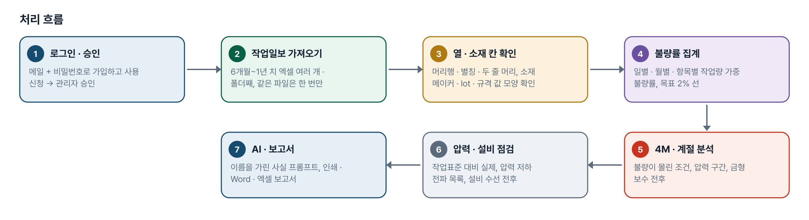
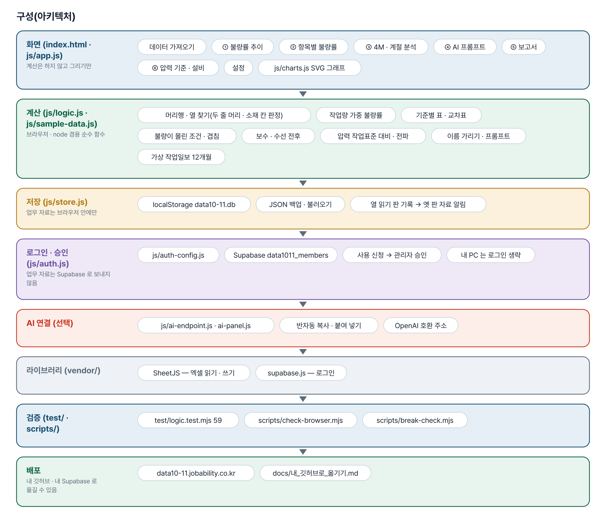
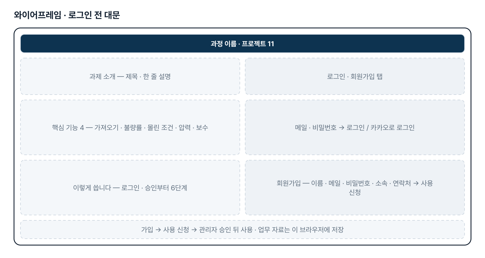
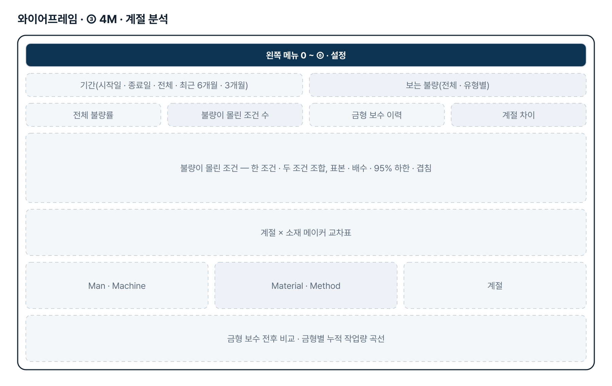
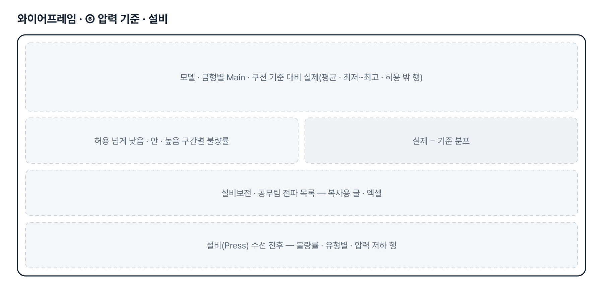
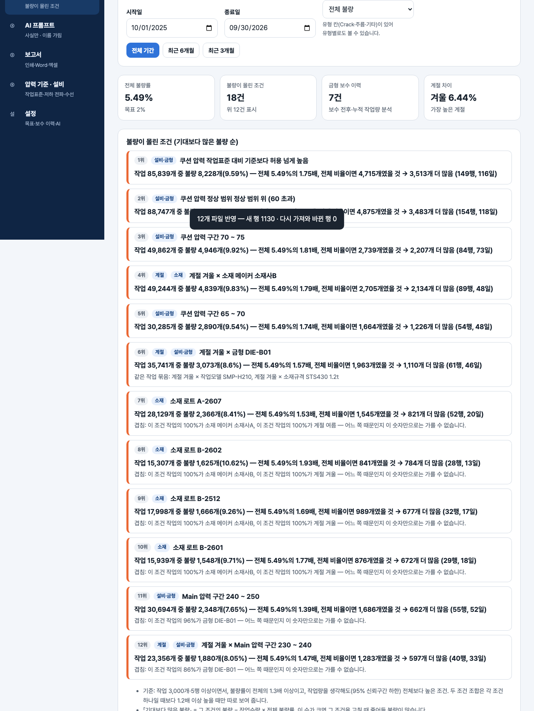

# Deep drawing press 불량 최소화 — 프로젝트 기획서 v2.0

- 기획: 이성헌 · 작성일 2026-11-10 · 현장 데이터 디지털화 전문가과정 · 2차수 프로젝트 11
- 바로 쓰기: https://data10-11.jobability.co.kr/
- 워드 판: `docs/기획서/data10-11_이성헌_Deepdrawingpress불량최소화_기획서_v2.0.docx`

## 개요

Deep drawing press 작업일보 엑셀을 여러 달 쌓아 일별 · 월별 · 금형 · 소재별 작업량 대비 불량률과 4M · 계절별 「불량이 몰린 조건」, 금형 보수 · 설비 수선 전후, 압력 작업표준 대비를 보여 주는 브라우저 도구입니다.

### 배경 · 현재 업무
- 높은 단가의 수입 자재를 쓰는 Deep drawing press 공정의 불량률이 약 5% 수준이고, 2% 수준으로 낮추는 것이 목표입니다.
- 작업일보(엑셀)에 작업일자 · 작업자 · Main 압력 · 쿠션 압력 · 금형 · 작업모델 · 소재 메이커 · 소재규격 · 작업수량 · 불량수량이 쌓이지만 묶어서 보기 어렵습니다.
- 불량(Crack)의 원인이 소재인지 프레스 압력인지 금형 상태인지 계절별 4M 근거로 가려내야 합니다.
- 모델 · 금형마다 압력 작업표준이 다르고, 압력이 기준보다 떨어지면 설비보전 · 공무팀에 알려야 합니다(3차 요청).

### 목표
- 작업일보 여러 달을 한꺼번에 넣어 일별 · 월별 작업량 대비 불량률과 목표 2% 대비 거리를 봅니다.
- 금형 · 소재 메이커 · 소재 lot · 소재규격 · 작업모델 · 작업자별 불량률을 표본 크기와 함께 비교합니다.
- 4M · 계절 조건 가운데 불량이 몰린 조건을 근거 숫자와 함께 찾습니다(원인 확정은 현장 확인).
- 금형 보수 · 설비 수선 전후와 압력 작업표준 대비 실제를 비교하고, 압력 저하 전파 목록을 만듭니다.

## 요구사항과 구현

| 기획서 요구 | 구현 |
|---|---|
| ① 작업 일별/월별 작업량 대비 불량률 분석표 | 작업량 가중 불량률(불량 합 ÷ 작업 합), 목표 2% · 지금 5% 선, 목표까지 줄일 불량 수, 엑셀 |
| ② 금형/소재별 작업량 대비 불량률 분석표 | 금형 · 소재 메이커 · 소재 lot · 소재규격 · 작업모델 · 작업자별 표, 표본 적음 표시, 금형 × 메이커 교차표 |
| 계절별 4M 근거로 Crack 원인을 추측할 데이터 | 「불량이 몰린 조건」 — 한 조건 · 두 조건 조합을 표본 · 배수 · 95% 하한으로 거르고 겹침 표시. AI 는 그 사실만으로 「추정」 정리 |
| 소재 문제 / 프레스 압력 문제 | Main · 쿠션 압력 구간과 정상 범위 아래 · 안 · 위, 계절 × 소재 메이커 교차표, 소재 lot 분석 |
| 금형 보수 시점 예측(사전 보수) | 일부 — 보수 전후 비교와 「보수 후 누적 작업량 이 구간부터 불량률 상승」 참고값. 예측은 이력이 쌓인 뒤 2단계 |
| 소재 메이커 · 소재규격 결과가 바뀐 것 같음(3차) | 두 줄 · 한 줄 머리의 애매한 「소재」 칸 결함 수정, 소재 칸 확인 카드 · 두 칸 바꾸기 · 열 연결 기억, 옛 판 자료 알림 |
| 소재 lot · 모델별 압력 작업표준 · 설비 수선 이력(3차) | 샘플에 소재 lot 칸, 압력 작업표준 표와 ⑥ 기준 대비 실제, 설비(Press) 수선 이력과 수선 전후 |
| 압력 저하 → 설비보전 · 공무팀 전파(3차) | 기준 − 허용보다 낮은 작업 목록 · 복사용 글 · 엑셀. 자동 발송은 하지 않음 |
| 팀 공유 | 2단계 — 지금은 브라우저 저장 + JSON 백업 |

## 주요 기능

- **작업일보 여러 달 가져오기** — 엑셀 여러 개 · 폴더째 넣으면 머리행과 열(두 줄 머리 · 별칭)을 찾고 소재 칸을 값 모양으로 확인합니다.
- **불량률 추이 · 항목별 표** — 일별 · 월별, 금형 · 소재 메이커 · lot · 규격 · 모델 · 작업자별 작업량 대비 불량률을 표본과 함께 봅니다.
- **4M · 계절 「불량이 몰린 조건」** — 한 조건 · 두 조건 조합을 표본 · 배수 · 95% 하한으로 걸러 근거 숫자와 겹침 표시를 붙여 보여 줍니다.
- **압력 기준 · 보수 · 수선** — 모델별 압력 작업표준 대비 실제와 전파 목록, 금형 보수 · 설비 수선 전후 불량률을 비교합니다.
- **AI 프롬프트 · 보고서** — 계산한 사실만 담고 금형 · 모델 · 메이커 · 작업자 이름을 별칭으로 가린 프롬프트, 인쇄 · Word · 엑셀 보고서.
- **로그인 · 사용 승인** — 회사 메일이나 개인 메일로 가입해 사용 신청을 하면 관리자가 승인합니다.

## 처리 흐름(파이프라인)

1. **로그인 · 승인** — 메일 + 비밀번호로 가입하고 사용 신청 → 관리자 승인
2. **작업일보 가져오기** — 6개월~1년 치 엑셀 여러 개 · 폴더째, 같은 파일은 한 번만
3. **열 · 소재 칸 확인** — 머리행 · 별칭 · 두 줄 머리, 소재 메이커 · lot · 규격 값 모양 확인
4. **불량률 집계** — 일별 · 월별 · 항목별 작업량 가중 불량률, 목표 2% 선
5. **4M · 계절 분석** — 불량이 몰린 조건, 압력 구간, 금형 보수 전후
6. **압력 · 설비 점검** — 작업표준 대비 실제, 압력 저하 전파 목록, 설비 수선 전후
7. **AI · 보고서** — 이름을 가린 사실 프롬프트, 인쇄 · Word · 엑셀 보고서

## 구성(아키텍처)

- **화면 (index.html · js/app.js)** — 데이터 가져오기 · ① 불량률 추이 · ② 항목별 불량률 · ③ 4M · 계절 분석 · ④ AI 프롬프트 · ⑤ 보고서 · ⑥ 압력 기준 · 설비 · 설정 · js/charts.js SVG 그래프
- **계산 (js/logic.js · js/sample-data.js)** — 머리행 · 열 찾기(두 줄 머리 · 소재 칸 판정) · 작업량 가중 불량률 · 기준별 표 · 교차표 · 불량이 몰린 조건 · 겹침 · 보수 · 수선 전후 · 압력 작업표준 대비 · 전파 · 이름 가리기 · 프롬프트 · 가상 작업일보 12개월
- **저장 (js/store.js)** — localStorage data10-11.db · JSON 백업 · 불러오기 · 열 읽기 판 기록 → 옛 판 자료 알림
- **로그인 · 승인 (js/auth.js)** — js/auth-config.js · Supabase data1011_members · 사용 신청 → 관리자 승인 · 내 PC 는 로그인 생략
- **AI 연결 (선택)** — js/ai-endpoint.js · ai-panel.js · 반자동 복사 · 붙여 넣기 · OpenAI 호환 주소
- **라이브러리 (vendor/)** — SheetJS — 엑셀 읽기 · 쓰기 · supabase.js — 로그인
- **검증 (test/ · scripts/)** — test/logic.test.mjs 59 · scripts/check-browser.mjs · scripts/break-check.mjs
- **배포** — data10-11.jobability.co.kr · docs/내_깃허브로_옮기기.md

## 화면 구성(와이어프레임)

## 규칙 · 판정 기준

- 불량률은 늘 작업량 가중(불량 합계 ÷ 작업수량 합계)입니다. 하루 불량률의 평균을 쓰지 않습니다.
- 「불량이 몰린 조건」은 ① 표본(작업 3,000개 · 5행) ② 전체의 1.3배 ③ 윌슨 95% 하한도 전체보다 높음, 세 겹으로 거릅니다. 두 조건 조합은 각 조건 하나일 때보다 1.2배 이상 · 하한도 높을 때만 보입니다.
- 조건의 작업량 70% 이상이 한 금형 · 메이커 · 작업자 · 계절에 몰려 있으면 「겹침」을 붙입니다. 원인 판정이 아니라는 문구를 화면 · 보고서 · 프롬프트에 함께 둡니다.
- 금형 보수 시점은 예측이 아니라 참고값입니다 — 보수 후 누적 작업량 구간별 불량률이 보수 직후보다 1.3배 이상 오른 뒤 내려오지 않는 첫 구간.
- 압력 저하 = 실제 압력이 작업표준 기준 − 허용 폭보다 낮은 작업. 전파 목록은 글 · 엑셀로만 만들고 자동으로 보내지 않습니다.
- AI 프롬프트에는 계산한 사실만 넣고 금형 · 모델 · 소재 메이커 · 작업자 · 로트 이름은 별칭으로 가립니다(기본). 비고 같은 자유 글은 넣지 않습니다.

## 검증

- 계산 규칙 테스트 59개 통과
- node test/logic.test.mjs 59개 — 열 찾기(두 줄 머리 · 애매한 소재 머리 · 값 모양), 행 읽기 · 중복, 작업량 가중 집계, 보수 · 수선 전후, 압력 작업표준 · 전파, 샘플 패턴, 이름 가리기, 보고서 · 저장 형식.
- scripts/check-browser.mjs — ② 의 탭 · 보는 불량 · 빠른 기간 · 정렬 216가지 상태마다 눌린 단추 = 그래프 = 표 = 원본을 따로 더한 값을 대조(BREAK=1 로 일부러 어긋내 검사가 잡는지 확인).
- scripts/break-check.mjs — 계산 규칙을 일부러 깨뜨려 해당 시험이 실패하는지 확인(원본은 스크립트 변수에만 두고 되돌림).

## 이번 판에서 하지 않는 것

- 업무 자료(작업일보 · 이력 · 작업표준)는 아직 팀 공유 DB 가 아니라 이 브라우저에 저장합니다. JSON 백업으로 옮깁니다.
- 실제 작업일보 견본을 아직 받지 않아 샘플은 제출 글 항목대로 만든 가상 값입니다. 정상 압력 범위 · 허용 폭은 확인 전입니다.
- 작업일보 압력 값이 기준 값 그대로면 기준 대비 실제 비교는 「기준 값을 적은 것」으로 알립니다 — 실제 압력(act) 값은 나중에 연결합니다.
- 금형 보수 시점 예측과 전파 자동 알림은 하지 않습니다.

## 다음 단계

- 팀 공유 저장 — 작업일보 · 이력을 팀이 함께 쌓기(요청자 Supabase)
- 실제 작업일보 견본으로 머리 모양 · 작업표준(허용 폭) · 불량 유형 확정, 실제 압력(act) 값 연결
- 보수 이력이 쌓인 뒤 금형 보수 시점 예측
- 압력 저하 전파 자동 알림(Make 등) · 성적서 연계

## 버전 이력

- **v2.0** (2026-11-10) — 최종 기획서 — 파이프라인 · 아키텍처 · 와이어프레임 정리 / 로그인 · 사용 신청 · 관리자 승인(요청자 Supabase 로 옮길 수 있게) / 로그인 전 대문
- **v1.3** (2026-10-27) — 실제 작업일보 머리 이름 점검 — 「소재 | 규격」 등 애매한 소재 머리, 값 모양 확인, 소재 칸 확인 카드 · 두 칸 바꾸기 · 열 연결 기억, 열 읽기 판 3
- **v1.2** (2026-10-27) — 버튼 · 결과 불일치 점검 — 옛 판 자료 알림, 판 맞추기(?v= · fresh-guard), 탭 칸 출처, 최근 N개월 날짜
- **v1.1** (2026-10-27) — 3차 반영 — 메이커 · 규격 확인(두 줄 머리 결함 수정), 소재 lot, 모델별 압력 작업표준, 설비 수선 이력, 압력 저하 전파
- **v1.0** (2026-10-20) — 1단계 — 가져오기 · 불량률 추이 · 항목별 · 4M · 계절 · AI 프롬프트 · 보고서 · 설정 / 가상 작업일보 12개월 · 기획서 v0.1
